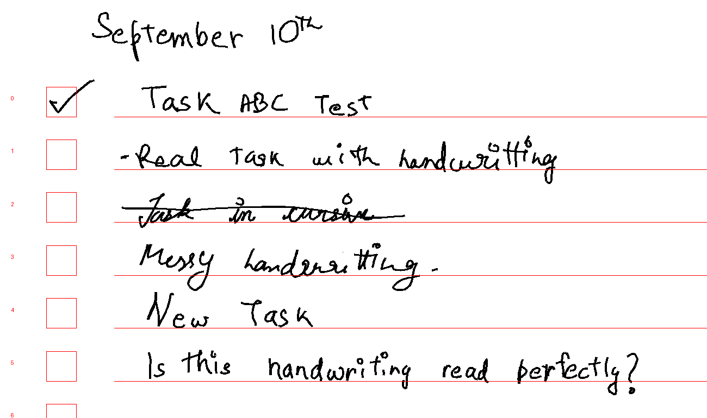

# remarkable-todo

I write my to-do list by hand on a reMarkable tablet. I like writing tasks down as they come up instead of typing them, but then I get no reminders, the list isn't on my phone or laptop, and nothing goes on my calendar.

So this reads the page when I put the pen back in its dock, and:
- new tasks go to Todoist and get the next free half hour on my Google Calendar today
- if I tick a task or cross it out on paper it gets completed in Todoist



## How it works

1. `tablet/pen_dock.sh` runs on the tablet and waits for the pen to go back in the dock. Then it copies the page to my Mac and runs `sync.py` there over ssh.
2. `sync.py` reads the page file with [rmscene](https://github.com/ricklupton/rmscene), which gives every pen stroke as a list of x, y points.
3. I use the Checklist template that comes with the tablet, so every task is on a row with a box. Each stroke goes in the row where its middle is, and a stroke inside the box is a tick. A stroke wider than 300 pixels counts as a line through the task. Either one means done.
4. The rest of the row is cropped out of a picture of the page and read with Apple's Vision framework. It runs on the Mac, no API key needed.
5. The rows are compared with `last_sync.json` (what the page looked like last time) so only new rows become tasks.

`utils.py` has the functions for reading the page. `check.py` draws the template rows on top of a page, I used it a lot for debuging.

## Try it

```
python3 -m venv .venv
source .venv/bin/activate
pip install -r requirements.txt
python check.py test_pages/after.rm
```

`test_pages/before.rm` is a page I wrote, `after.rm` is the same page after ticking one task, crossing one out and adding two more.
